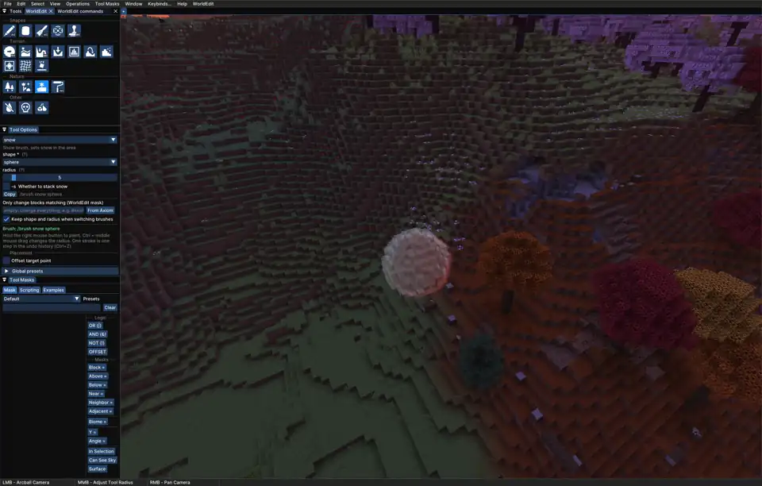
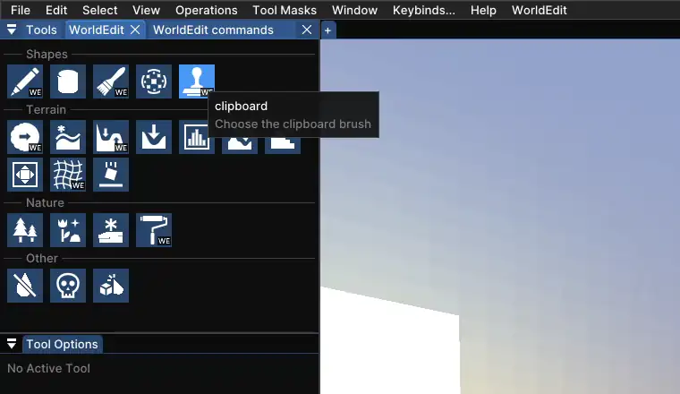
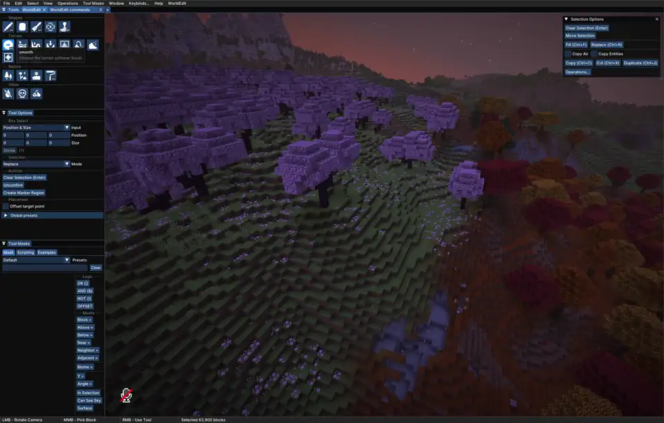
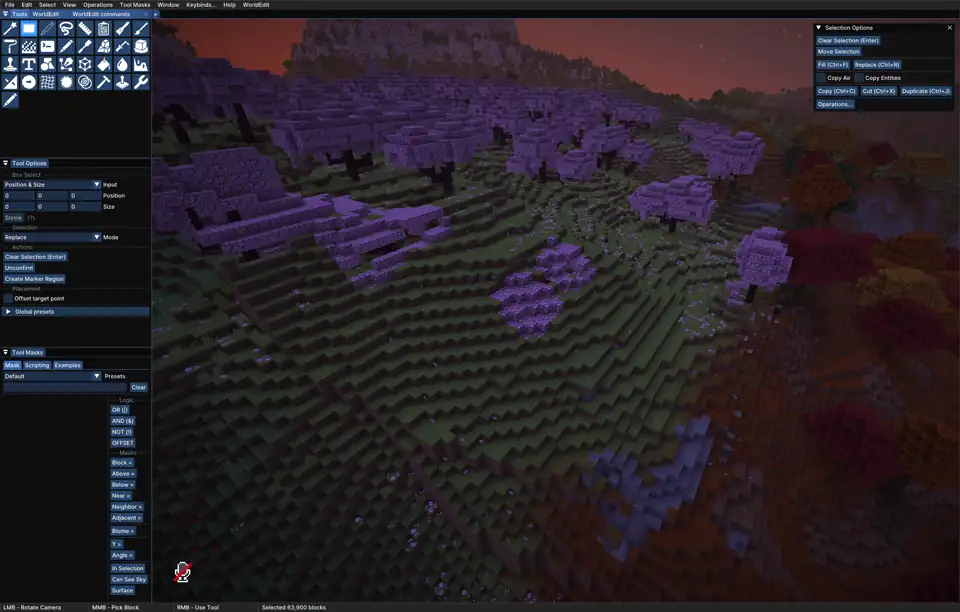
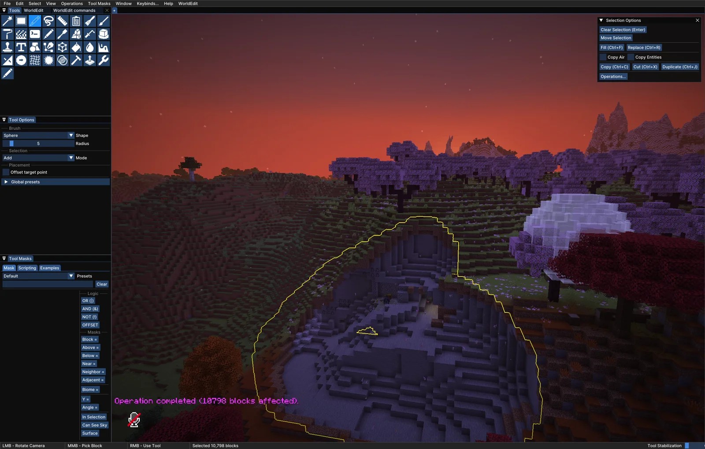

**Axiom: WorldEdit Tools** brings [WorldEdit](https://modrinth.com/mod/worldedit) into the [Axiom](https://modrinth.com/mod/axiom) editor. Every WorldEdit command gets a form, WorldEdit's brushes get their own tool tab, Axiom selections work with WorldEdit, and both mods share **one undo history** — Ctrl+Z in Axiom undoes WorldEdit edits too.

*Unofficial — not affiliated with or endorsed by Moulberry, the Axiom project or EngineHub.*

**Singleplayer only:** the addon runs WorldEdit on the integrated server.

## Features

### 🖌️ WorldEdit brushes as Axiom tools
All of WorldEdit's brushes in a **WorldEdit** tab next to Axiom's Tools: shapes, terrain (smooth, raise, lower, erode, dilate, morph, gravity…), nature (forest, feature, snow, biome) and more.

- Paint the Axiom way: hold the right mouse button, **Ctrl + middle mouse drag** changes the radius, the brush shape is previewed under the cursor.
- Settings sit in *Tool Options* and apply instantly — sliders for sizes, searchable lists for tree types, shapes and items.
- A new brush starts with your active block; shape and radius carry over when you switch brushes.
- *Apply* and *Paint* modes for forest, set and item; an optional WorldEdit mask.

### 🧱 Patterns with Axiom's block list
Pattern fields show Axiom's own block list with percentages. **Drag blocks** onto it from the hotbar, Inventory, Active Block or the Palette. Every pattern and mask is checked by WorldEdit's parser while you type, and *From Axiom* turns your Tool Masks mask into WorldEdit syntax.

### ⚙️ Operations, every command, console
- **Operations** window: what Axiom does not have — //naturalize, //overlay, //generate and //deform with formula presets, //regen, //feature, //structure, biomes, mobs, selection shapes (ellipsoid, cylinder, sphere), clipboard exchange, schematics and CraftScripts.
- **All commands**: all 185 WorldEdit commands with search, each with a form built from WorldEdit's own command tree.
- **Console** with WorldEdit's answers and a line for any command.

### 🔗 Selections and undo, shared
- Axiom's selection is what WorldEdit works on — including magic, lasso and freehand selections of any shape. WorldEdit's selection changes (//expand, //shift, the wand…) show up in Axiom.
- WorldEdit edits go into **Axiom's history**: Ctrl+Z, Ctrl+Y and the History window undo them together with Axiom's own edits — chests, biomes and generated trees included.

Axiom's selection *is* WorldEdit's selection: select with any Axiom tool, then run any WorldEdit command on it. Here a lasso selection of 10,798 blocks gets exactly 10,798 blocks changed by WorldEdit:

## Requirements

- Minecraft **26.3**, Fabric Loader 0.16+, Java 25
- **Axiom 6.1.5** and **WorldEdit 7.4.6** (Fabric) — both required
- Client-side; works in singleplayer worlds. WorldEditCUI is optional.

The addon hooks into Axiom's internals, so each release targets one Axiom version line.

## Source & issues

Open source under GPL-3.0: [github.com/Vivegass/axiom-worldedit-gui](https://github.com/Vivegass/axiom-worldedit-gui). Bug reports and ideas are welcome in the [issue tracker](https://github.com/Vivegass/axiom-worldedit-gui/issues).
